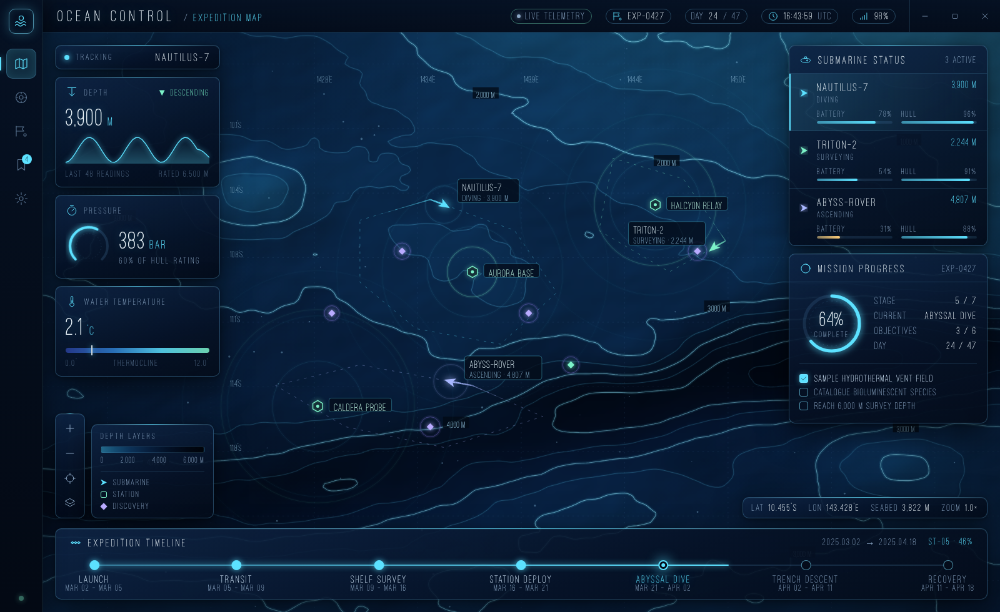

# Ocean Control

A desktop console for deep ocean exploration and monitoring, built with **Electron** and **three.js**.
All data is simulated.



## Requirements

- [Node.js](https://nodejs.org) 18 or newer (includes npm)
- macOS, Windows or Linux

## Install and run

```bash
cd ocean-control
npm install      # downloads Electron and three.js
npm start        # launches the app
```

`npm run dev` starts the app with DevTools open.

## What's inside

| Section | What it does |
| --- | --- |
| **Expedition Map** | Layered bathymetry (darker = deeper) with illuminated depth lines, animated markers, moving submarine tracks and neon range circles. Drag to pan, scroll to zoom, click a marker to select it. |
| **Inspector** | Selecting an object opens a rotatable 3D model with an information panel next to it. |
| **Telemetry panels** | Live depth, pressure and temperature for the tracked submarine, plus submarine status and mission progress. |
| **Timeline** | The seven expedition stages. Click a stage to open it in Mission Details. |
| **Discovery Library** | A filterable catalogue of creatures, vehicles, stations and sites, with a 3D specimen viewer. |
| **Mission Details** | Expedition overview, stage timeline, depth profile, objectives, crew and log. |
| **Saved Items** | Bookmarked objects with editable field notes. |
| **Settings** | Units, glow, contour interval, map layers, auto-rotate, telemetry rate and more. |

Saved items and settings are stored as JSON in Electron's user-data folder.

## Project structure

```
ocean-control/
├── main.js              Electron main process (window, IPC, JSON store)
├── preload.js           Safe bridge between main and renderer
├── package.json
└── src/
    ├── index.html       App shell (ES modules + import map for three.js)
    ├── styles/main.css  Theme: colours, glass panels, typography
    ├── assets/fonts/    Ostrich Sans Medium (the supplied font)
    └── js/
        ├── app.js       Navigation, top bar, start-up
        ├── data.js      Simulated expedition data (edit here)
        ├── telemetry.js Live sensor simulation
        ├── store.js     State, persistence, unit formatting
        ├── map.js       Ocean map (Canvas 2D)
        ├── models.js    Procedural 3D models
        ├── viewer.js    3D viewer and thumbnail renderer
        ├── icons.js     Thin line icons
        └── views/       One file per section
```

## Customising

- **Data:** edit `src/js/data.js`. Positions are normalised (0–1) across the survey area.
- **Colours:** edit the CSS variables at the top of `src/styles/main.css`.
- **Glass blur:** Settings → Units & display. *Auto* turns the blur off on software-rendered GPUs.

## Notes

- The font is applied with `text-rendering: geometricPrecision`. Without it, some thin strokes drop out at small sizes on Linux.
- Placeholder copy is Lorem Ipsum.

## Portfolio scope and validation

This is an interactive desktop prototype using simulated ocean, mission and sensor data. It does not connect to real vehicles or instruments. Some explanatory copy is placeholder text.

Dependency installation from the lockfile completed with lifecycle scripts disabled, and all 16 JavaScript files passed syntax checks. Electron launch, native binary download and interactive workflows remain unverified in the preparation environment. A normal `npm ci` is required before running the desktop app.

## Font credit

Ostrich Sans by Tyler Finck / The League of Moveable Type: https://www.theleagueofmoveabletype.com/ostrich-sans
